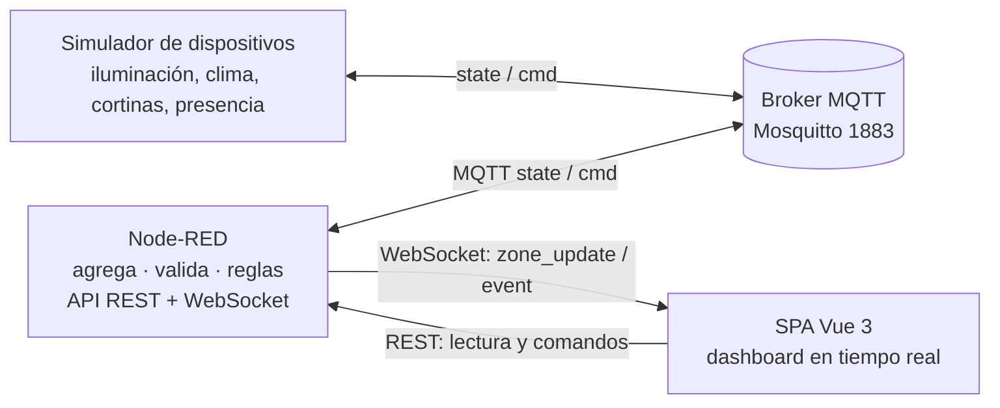
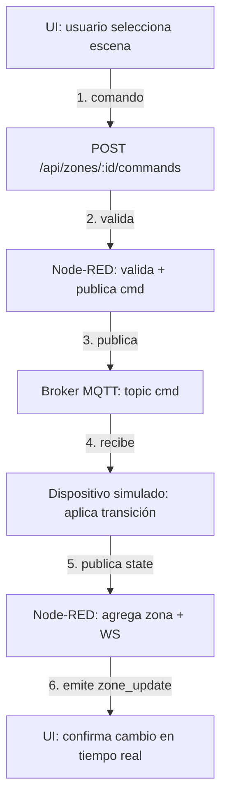
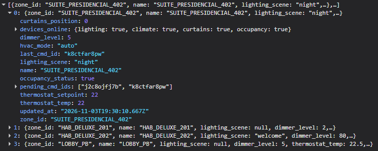
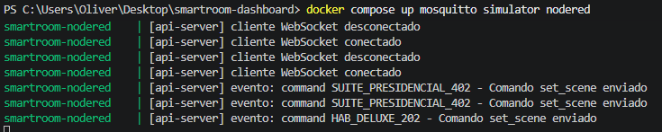
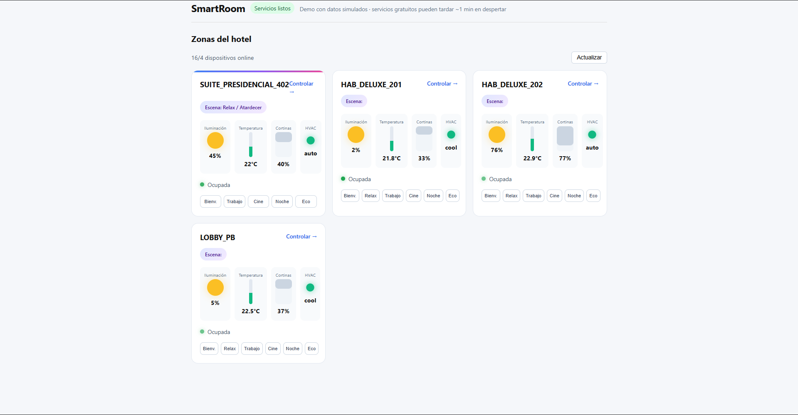
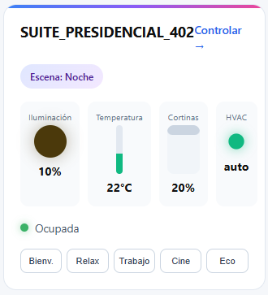

# SmartRoom Hospitality Dashboard

Simulación de control de habitaciones de hotel: **dispositivos → MQTT → Node-RED (API REST + WebSocket) → SPA Vue 3**.

---

## 🎯 En qué consiste

Construí una cadena completa de integración IoT: dispositivos simulados publican su estado por MQTT, Node-RED los agrega, valida comandos y aplica reglas de ahorro, y un dashboard en Vue 3 lo muestra todo en tiempo real.



---

## 🛠️ Lo que construí

| Pieza | Qué hace | Tecnología |
|-------|----------|------------|
| **Simulador** | 4 zonas de hotel con iluminación, clima, cortinas y presencia | Node.js + MQTT |
| **Broker** | Mosquitto con autenticación y mensajes retenidos | Docker |
| **API** | REST de lectura y comandos, reglas de ahorro, WebSocket en tiempo real | Node-RED + Node.js |
| **Dashboard** | SPA con controles por zona y estado en vivo | Vue 3 + Vite + Pinia + Axios |

---

## ⚡ Flujo de un comando

```text
┌─────────────┐    POST /api/zones/:id/commands    ┌──────────────┐
│   Usuario   │ ─────────────────────────────────► │   UI Vue 3   │
└─────────────┘                                    └──────────────┘
                                                         │
                                                         ▼
                                              ┌──────────────────┐
                                              │   Node-RED       │
                                              │  valida comando  │
                                              │  + cabecera      │
                                              │  x-demo-key      │
                                              └──────────┬───────┘
                                                         │ publica cmd
                                                         ▼
                                              ┌──────────────────┐
                                              │   Broker MQTT    │
                                              │  topic: .../cmd  │
                                              └──────────┬───────┘
                                                         │ suscribe
                                                         ▼
                                              ┌──────────────────┐
                                              │   Dispositivo    │
                                              │   simulado       │
                                              │  aplica transición│
                                              └──────────┬───────┘
                                                         │ publica state
                                                         ▼
                                              ┌──────────────────┐
                                              │   Node-RED       │
                                              │  agrega zona     │
                                              │  + WebSocket     │
                                              └──────────┬───────┘
                                                         │ emite
                                                         ▼
                                              ┌──────────────────┐
                                              │   UI Vue 3       │
                                              │  confirma cambio │
                                              └──────────────────┘
```



---

## 🧪 Lo que aprendí y apliqué

- **MQTT:** topics con retained messages, LWT, QoS 1 y autenticación por usuario/clave.
- **APIs REST y WebSocket:** endpoints de lectura y comandos, validación de payloads, CORS restringido, rate limiting.
- **Automatización:** reglas de vacancia (eco), llegada (welcome), alerta térmica y dispositivo caído.
- **Docker:** Compose con Mosquitto, simulador y Node-RED.
- **CI:** GitHub Actions que instala dependencias y ejecuta pruebas de cada servicio.
- **Vue 3:** Pinia para estado, WebSocket para tiempo real, Axios para comandos.

---

## 🚀 Cómo correrlo en 3 pasos

```bash
# 1. Levantar Mosquitto
docker compose up mosquitto

# 2. Levantar simulador y Node-RED
docker compose up simulator nodered

# 3. Levantar el dashboard
cd services/web
npm install
npm run dev   # http://localhost:5173
```

---

## 📸 Evidencias visuales

**API REST de Node-RED respondiendo** (`/api/health`, `/api/zones`, `POST /commands`)
   
   

**Dashboard Vue 3 con 4 zonas en tiempo real**
   

**Cambio de escena desde la UI en tiempo real**
   

---