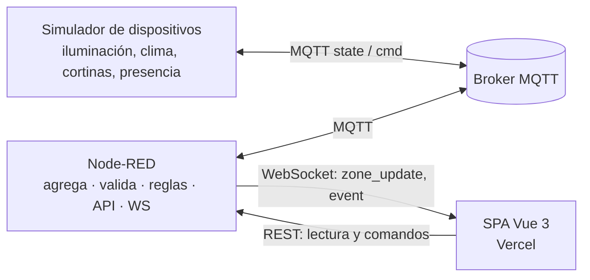

# Arquitectura y contratos (fuente de verdad)

> Si cambias un topic, payload, endpoint, mensaje WebSocket, escena o regla, actualiza este archivo en el mismo commit.

## Diagrama

Flujo de un comando: UI → `POST /api/zones/:id/commands` → Node-RED valida y publica `.../cmd` → el dispositivo aplica con transición y publica `.../state` (retained) con `last_cmd_id` → Node-RED actualiza la zona y emite por WebSocket → la UI confirma.

## Zonas y propiedad
`PROPERTY_ID = demo-hotel`. Zonas: `SUITE_PRESIDENCIAL_402`, `HAB_DELUXE_201`, `HAB_DELUXE_202`, `LOBBY_PB`. Dispositivos por zona: `lighting`, `climate`, `curtains`, `occupancy`.

## Topics MQTT
`smartroom/<property>/<zone_id>/<device>/<kind>`
| kind | Quién publica | Retained | QoS | Contenido |
|---|---|---|---|---|
| `state` | dispositivo | sí | 1 | Estado actual del dispositivo |
| `cmd` | Node-RED | no | 1 | Orden para el dispositivo |
| `status` | dispositivo (LWT) | sí | 1 | `online` / `offline` |
Ejemplo: `smartroom/demo-hotel/SUITE_PRESIDENCIAL_402/lighting/state`.
Node-RED se suscribe a `smartroom/demo-hotel/+/+/state` y `.../status`; el simulador a `smartroom/demo-hotel/+/+/cmd`.
Al arrancar, los mensajes retained reconstruyen el estado de todas las zonas.

## Payloads de estado por dispositivo (JSON)
Todos incluyen `zone_id`, `ts` (ISO 8601 UTC) y `last_cmd_id` (o `null`).
- **lighting:** `{ "lighting_scene": "relax_sunset", "dimmer_level": 45 }`
- **climate:** `{ "thermostat_temp": 21.5, "thermostat_setpoint": 22.0, "hvac_mode": "auto" }` (`hvac_mode`: `auto|cool|heat|off`)
- **curtains:** `{ "curtains_position": 40 }` (0 cerradas, 100 abiertas)
- **occupancy:** `{ "occupancy_status": true }`

## Payload de comando (Node-RED → dispositivo)
`{ "cmd_id": "uuid", "type": "set_dimmer", "value": 60, "origin": "dashboard", "ts": "..." }`

## Modelo agregado de zona (lo que ve la API y la UI)
```json
{
  "zone_id": "SUITE_PRESIDENCIAL_402",
  "name": "Suite Presidencial 402",
  "lighting_scene": "relax_sunset",
  "lighting_scene_label": "Modo Relax / Atardecer",
  "lighting_system": "Lutron HomeWorks (simulado)",
  "dimmer_level": 45,
  "thermostat_temp": 21.5,
  "thermostat_setpoint": 22.0,
  "hvac_mode": "auto",
  "curtains_position": 40,
  "occupancy_status": true,
  "devices_online": { "lighting": true, "climate": true, "curtains": true, "occupancy": true },
  "pending_cmd_ids": [],
  "updated_at": "2026-11-01T10:00:00Z"
}
```

## Escenas
| id | Etiqueta | dimmer | cortinas | setpoint |
|---|---|---|---|---|
| `welcome` | Bienvenida | 80 | 100 | 22.0 |
| `relax_sunset` | Modo Relax / Atardecer | 45 | 40 | 22.0 |
| `work` | Trabajo | 90 | 100 | 22.0 |
| `cinema` | Cine | 10 | 0 | 21.0 |
| `night` | Noche | 5 | 0 | 21.0 |
| `eco` | Ahorro (habitación vacía) | 0 | 0 | 25.0 |
Aplicar una escena fija iluminación, cortinas y consigna (el dispositivo correspondiente recibe su propio `cmd`).

## Comandos aceptados y validación
| `type` | `value` | Regla |
|---|---|---|
| `set_scene` | id de escena | debe existir |
| `set_dimmer` | entero | 0–100 |
| `set_setpoint` | número | 16–30, paso 0.5 |
| `set_hvac_mode` | string | `auto|cool|heat|off` |
| `set_curtains` | entero | 0–100 |
| `sim_occupancy` | booleano | solo demo: obliga al sensor simulado a cambiar |
Cualquier otro valor → 400 con mensaje claro.

## REST (prefijo `/api`)
| Ruta | Descripción |
|---|---|
| `GET /health` | `{ status, mqtt: "connected|disconnected", zones, uptime_s }`; sin autenticación |
| `GET /zones` | lista de zonas (modelo agregado) |
| `GET /zones/:zone_id` | una zona; 404 si no existe |
| `POST /zones/:zone_id/commands` | cuerpo `{ type, value }`; header `x-demo-key`; responde `202 { cmd_id }`; 400 validación, 401 clave, 404 zona, 429 límite |
| `GET /events?limit=50` | últimos eventos (máx. 100, en memoria) |
Errores: `{ "error": { "code": "...", "message": "..." } }`. CORS limitado a `CORS_ORIGIN`.

## WebSocket `/ws/zones`
Servidor → cliente: `{"type":"zone_update","zone":{...}}`, `{"type":"event","event":{...}}`, `{"type":"hello","server_time":"..."}`.
Cliente → servidor: `{"type":"ping"}` cada ~60 s mientras la pestaña esté visible (mantiene despierto el servicio en Render).
El cliente carga primero `GET /zones` y luego abre el WebSocket; al reconectar vuelve a cargar el snapshot.

## Eventos
`{ "id", "ts", "zone_id", "type", "message", "data" }` con `type` ∈ `command | state_change | automation | alert | device_status`.

## Reglas de automatización (Node-RED)
| Id | Condición | Acción |
|---|---|---|
| R1 vacancia | `occupancy_status=false` continuo ≥ `VACANT_MINUTES` (demo: 2) | `set_scene eco`; evento `automation` |
| R2 llegada | `occupancy_status=true` y escena `eco` | `set_scene welcome`; evento `automation` |
| R3 alerta térmica | `|temp − setpoint| > 3` en 3 estados seguidos con `hvac_mode ≠ off` | evento `alert` (máx. una cada 10 min por zona) |
| R4 dispositivo caído | `status=offline` | evento `device_status` |

## Comportamiento del simulador
- Transiciones: dimmer y cortinas cambian ~10 puntos/s; temperatura se acerca al setpoint ~0.1 °C cada 5 s (con `hvac_mode=off` deriva hacia 26 °C).
- Publica al cambiar (con tope de 1 msg/s por topic) y un latido cada 30 s; `status` con Last Will.
- Presencia: la suite parte ocupada y solo cambia con `sim_occupancy`; las demás zonas alternan al azar cada 1–3 min.
- Un único cliente MQTT para todos los dispositivos (cuida el límite de conexiones del plan gratuito).

## Variables de entorno
Backend: `MQTT_URL`, `MQTT_USER`, `MQTT_PASSWORD`, `PROPERTY_ID`, `SIMULATOR_ENABLED`, `NODERED_EDITOR_ENABLED`, `NODERED_CREDENTIAL_SECRET`, `DEMO_KEY`, `CORS_ORIGIN`, `VACANT_MINUTES`, `RATE_LIMIT_PER_MIN`, `PORT`.
Frontend (build): `VITE_API_URL`, `VITE_WS_URL`, `VITE_DEMO_KEY`.
