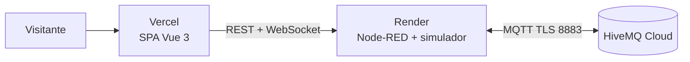

# Despliegue gratuito: HiveMQ Cloud + Render + Vercel

> Límites verificados por búsqueda el 2026-10-31. Los planes gratuitos cambian: **reconfirmar en la página oficial de cada proveedor** antes de depender de ellos y el día antes de enviar el CV.

## Piezas
| Pieza | Proveedor / plan | Qué aloja | Límites relevantes |
|---|---|---|---|
| Broker MQTT | HiveMQ Cloud Serverless (gratis) | MQTT con TLS y WebSocket | 100 conexiones, 10 GB/mes, sin SLA |
| Node-RED + simulador | Render, servicio web Docker (gratis) | API REST, WebSocket, reglas, simulador | Se duerme tras 15 min sin tráfico HTTP o mensajes WebSocket entrantes; despertar ≈ 1 min; 750 h/mes compartidas; 512 MB; disco efímero |
| Frontend | Vercel Hobby (gratis) | SPA Vue 3 estática | Solo uso personal no comercial (un portafolio encaja); 100 GB de transferencia; si se excede un límite, se pausa |

## Topología en la nube

## Decisión: un solo contenedor con dos procesos
Render gratuito permite pocos servicios. La imagen de `services/nodered/` arranca con `start.js`, que lanza Node-RED y, si `SIMULATOR_ENABLED=true`, el simulador como proceso aparte (sigue siendo un cliente MQTT independiente, igual que en local). Es un compromiso consciente frente a "un proceso por contenedor"; documentarlo en el README como decisión y como punto a mejorar.

## Estrategia de despertar
1. Al abrir la SPA se muestra el banner "Despertando servicios (hasta ~1 min)" mientras se consulta `GET /api/health` con reintentos.
2. Al despertar, Node-RED se reconecta a HiveMQ y los mensajes *retained* reconstruyen el último estado conocido; el simulador retoma desde ahí.
3. Con la pestaña visible, la SPA envía `{"type":"ping"}` por WebSocket cada ~60 s (mensaje entrante que mantiene el servicio despierto). Con la pestaña oculta, deja de enviarlo.
4. Sin visitantes, todo se duerme solo. **No** usar pings externos permanentes: gastan las 750 h mensuales y van contra el espíritu del plan.

## Node-RED en producción
- `settings.js`: `uiPort` desde `PORT`; editor y API de administración deshabilitados cuando `NODERED_EDITOR_ENABLED=false` (por ejemplo `httpAdminRoot: false`; verificar en la documentación vigente de Node-RED); `credentialSecret` desde entorno; CORS para `CORS_ORIGIN`.
- Flujos (`flows.json`) y módulos dentro de la imagen. Editar en local, exportar al repo, reconstruir.
- Credenciales MQTT por variables de entorno. Verificar en la documentación de Node-RED cómo inyectarlas en el nodo de broker (los campos de credenciales pueden requerir un mecanismo distinto al de otros campos) y documentar la solución elegida.
- `/api/health` responde sin autenticación (lo usa Render como health check).

## HiveMQ Cloud
- Crear clúster Serverless y dos credenciales: una para Node-RED y otra para el simulador (o una sola si el plan limita; anotarlo).
- Conexión por TLS, puerto 8883. Para la demo basta una conexión por proceso (≈ 2 de las 100 disponibles).
- Presupuesto de mensajes: publicar al cambiar con tope de 1 msg/s por topic y latido de 30 s; con 16 dispositivos son del orden de pocos MB al día, muy lejos de 10 GB/mes.

## Vercel
- Importar el repo, **Root Directory** = `services/web`, preset Vite, variables `VITE_API_URL`, `VITE_WS_URL`, `VITE_DEMO_KEY` (esta última es pública por diseño).
- `vercel.json` con *rewrite* de todas las rutas a `index.html` (SPA con Vue Router en modo historial).
- Despliegue automático por push a `main`; ramas generan previews.

## Matriz de secretos
| Variable | Render | Vercel | GitHub Actions | Repo |
|---|---|---|---|---|
| `MQTT_USER` / `MQTT_PASSWORD` | sí | no | no | no |
| `NODERED_CREDENTIAL_SECRET` | sí | no | no | no |
| `DEMO_KEY` | sí | no | no | no |
| `VITE_DEMO_KEY` (misma clave, pública) | no | sí | no | no |
| `CORS_ORIGIN` | sí | no | no | ejemplo sin valor real |

## Prueba temprana (al terminar F2, ~30 min)
Crear clúster HiveMQ, desplegar la imagen en Render, confirmar `/api/health` en "connected" y ver datos entrando por `GET /api/zones` desde el navegador. Detecta pronto TLS, credenciales y CORS.

## Checklist antes de enviar el CV
- [ ] Probar el link desde ventana privada y desde el celular; medir el tiempo de despertar.
- [ ] Cambiar una escena y ver la confirmación; dejar vacía la suite y ver la regla R1.
- [ ] Editor de Node-RED inaccesible; sin secretos en repo ni historial.
- [ ] README con GIF/video de respaldo por si un servicio gratuito falla ese día.
- [ ] Aviso visible: "Demo con datos simulados; servicios gratuitos que pueden tardar ~1 min en despertar".
- [ ] Revisar panel de Render (horas usadas), HiveMQ y Vercel (sin avisos de límite).
- [ ] Probar enlaces de repo, demo y README el mismo día del envío.
